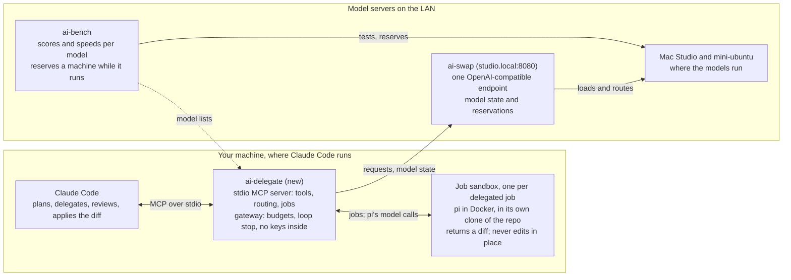

# ai-delegate: design

Status: M1, M2 and M3 built 2026-11-13 (the Houtini trial was skipped). Written 2026-11-10;
where the build departed from this design, the section says so.

## Purpose and scope

ai-delegate is a planned fifth tool in the suite: an MCP server that lets Claude Code hand bounded work to the local models behind ai-swap, while Claude keeps the planning and the final say. M1 is built; the Houtini trial was skipped in favour of trialling M1 itself (see Evaluation plan).

- In scope: short questions and reviews answered by a local model, and delegated coding jobs that run in a throwaway copy of the repo and come back as a diff.
- Out of scope: running Claude Code itself on a local model (`claude-swap` already does that), and multi-task orchestration (that is ai-factory).

## Prior art

Two existing servers cover the two halves of the idea; neither knows anything about how our models are hosted.

| Project | Pattern | What it does | Backends |
| --- | --- | --- | --- |
| [Houtini LM](https://houtini.com/tools/houtini-lm/) (`@houtini/lm`, Node) | Ask | `chat` for delegated questions, `code_task` for low-temperature code review; Claude stays the architect and checks the output | Any OpenAI-compatible endpoint (LM Studio, Ollama, vLLM, llama.cpp, hosted APIs) |
| [local-vibes](https://github.com/OpenSourceWTF/local-vibes) | Delegate | The local model runs its own agent loop with file and shell tools in a working directory, then returns a summary and a git change report; installs as a Claude Code plugin with a skill that says when to delegate | OpenAI-compatible (Ollama by default) |

What the suite adds that they lack:

- **Swap awareness.** ai-swap knows which model is loaded on each machine and when ai-bench has a machine reserved. Swapping a model in takes a minute or more, so routing to a loaded model matters.
- **Measured routing.** ai-bench has per-model scores and speeds, so each tool can default to the model that measured best for that kind of work.
- **A proven agent harness.** ai-factory already runs pi in a sandbox behind a gateway with budgets and loop detection, and the future-lab run shook out its failure modes (see Long-running jobs and limits).

## Tools exposed to Claude Code

Six tools in two groups: quick calls that answer within one MCP request, and delegated jobs that run for minutes and are polled.

| Tool | Group | Takes | Returns |
| --- | --- | --- | --- |
| `models` | Quick | nothing | Each model: machine, loaded or not, context window, measured speed, what ai-bench rates it for |
| `ask` | Quick | A prompt, optional files to include, optional model | The model's answer, the model used, tokens and seconds |
| `review` | Quick | A diff or files, and what to look for | Findings as a list, low temperature |
| `delegate` | Job | A task in plain words, the repo path, done-when criteria, optional model and time limit | A job id at once |
| `job_status` | Job | A job id | State, elapsed time, the agent's last few actions |
| `job_result` | Job | A job id | Summary, the diff, test output if it ran tests, and how to apply the diff |

Claude decides what to delegate; a skill shipped with the server says when delegation pays (mechanical edits, boilerplate, first drafts of tests) and when it doesn't (design, anything needing the whole conversation).

- Open question: whether `review` earns its own tool or is `ask` with a preset prompt. M1 makes it a tool: its own system prompt, temperature 0.2, and `git diff` ranges read by the server.

## Architecture

ai-delegate is a local stdio MCP server, a new repo in the suite, that uses ai-swap as its only way to reach models.

Claude Code talks only to ai-delegate; every model call, including the sandboxed agent's, goes through ai-delegate's gateway to ai-swap, which picks the machine.

Why a separate project and not part of ai-swap:

- **Delegation needs the working tree.** A job works on the repo Claude is in, so it must run where Claude Code runs. ai-swap runs on the model servers.
- **ai-swap stays a router.** It loads models and routes requests; an agent loop, worktrees and Docker don't belong in it.
- **What ai-swap may gain:** a small, stable status endpoint for routing, if the current one isn't enough. The quick tools could later also be served from ai-swap over HTTP (open question).

## Model routing

A call names a model, or names a kind of work and lets ai-delegate pick; either way the pick avoids making a machine swap models when it can.

1. **Kind of work → candidates.** Each tool has an ordered list of models, taken from ai-bench results: for example fast drafting on flint or nemotron-lightning, careful review on ThinkingCap. The lists live in config and are regenerated from ai-bench, not hand-maintained.
2. **Prefer what is loaded.** ai-swap reports each model's state. A loaded candidate wins over a better-ranked one that would need a swap, unless the call says otherwise.
3. **Respect reservations.** While ai-bench has a machine reserved, its models are skipped; if no candidate is left, the call says so instead of waiting silently.
4. **Report the choice.** Every result names the model and machine used, so Claude (and the user) can see what answered.

This is the same swap-avoidance idea as ai-factory's residency rules, read from the same ai-swap status endpoint.

## Delegation safety

A delegated job never touches the user's working tree: it works in its own copy of the repo and hands back a diff that Claude decides whether to apply.

- **A clone per job (built; was "worktree per job").** A `git worktree`'s `.git` is a file pointing into the caller's `.git`, a path that doesn't exist inside the container, so git would fail there. Each job instead gets a `git clone --local` (objects hard-linked, so cheap) at HEAD plus the caller's uncommitted changes by default, committed in the clone as the job's base. It adds no branches to the caller's repo, and its `origin` is removed. It is kept until the job is discarded.
- **Diff back, not edits in place.** `job_result` returns the diff and the commands to apply it; Claude reviews it like any other change.
- **Sandbox by default (built).** Three levels. `docker` (the default): pi runs in a container with only the clone mounted, reusing ai-factory's executor image. The container is on an internal Docker network whose only other member is a relay (socat) to this process's gateway, so the agent reaches its model and nothing else. `local`: pi runs as a host process in the clone, with no isolation; results say so. A repo's toolchain comes from `.ai-delegate/Dockerfile` (or ai-factory's `.ai-factory/Dockerfile`), built once and cached by hash, because the base image has no language runtimes.
- **Middle level, `host` (built, tested on macOS):** pi as a host process under Anthropic's sandbox-runtime (`srt`), which is Seatbelt on macOS and bubblewrap on Linux behind one config, so one implementation covers both. Per job, ai-delegate writes srt settings: writes limited to the clone and a scratch dir; credential stores, ai-delegate's own state and other jobs unreadable (the job's dir let back in); network only `127.0.0.1:<gateway port>` through srt's proxy. The job gets a minimal environment (no tokens from the parent). Two srt details it works around: srt puts `127.0.0.1` in `NO_PROXY`, which would send the gateway call around the proxy into a refused connection, so the command unsets it and sets `NODE_USE_ENV_PROXY=1` for pi; and srt keeps its sockets in `TMPDIR`, so the job's scratch `TMPDIR` is set inside the sandbox (its path is too long for a socket on macOS). Weaker than Docker (same kernel and uid, the rest of the disk readable) but it keeps the host's toolchains and caches, and needs no Docker: the case of a laptop. A preflight runs `srt -c true` once and reports why it can't (missing bwrap/socat/rg, or Ubuntu 24.04's userns restriction).
- **Budgets.** Per job: wall-clock limit, model calls, new tokens (counted as in ai-factory#18), and changed lines. Hitting one ends the job with what it got so far.
- **No secrets in the sandbox.** Node API keys stay on the host side of the gateway, as in ai-factory.

## Long-running jobs and limits

Local models are slow enough that delegation has to be asynchronous: ThinkingCap on the R9700 writes about 37 tokens a second, and future-lab's tasks took 35 to 100 minutes each.

- **Start, then poll.** `delegate` returns a job id immediately; Claude checks `job_status` and collects `job_result`. Quick tools (`ask`, `review`) keep a short limit and say so when a model is too slow for it.
- **Output budget for thinking models.** Give agents a quarter of the context window per reply, up to 32k tokens; at 8k, ThinkingCap reasoned until it was cut off and wrote nothing (ai-factory#16).
- **Long output lines.** Read agent output in chunks; pi's JSON events can carry a whole file on one line (ai-factory#15).
- **Count new tokens.** Budget the prompt the model hasn't seen plus its output, not every resent prompt (ai-factory#18).
- **Tell the agent its tools.** Give pi its grep, find and ls tools, with rg, fd and jq installed, and say so in the briefing (ai-factory#20).
- **Don't trust a "no problems" note over the tests.** Act on an agent's report only when the tests agree (ai-factory#17).

## Persistent job daemon (built)

Today Claude Code starts one ai-delegate process per session, over stdio, and that process
holds everything: the job manager, the gateway, the Docker relay. Three things follow:

- **A job dies with its session.** Jobs take 35 to 100 minutes on local models, longer than
  many sessions. When the process ends, its containers are swept and the job is marked
  interrupted.
- **Limits are per session, not per machine.** `max_running: 2` is counted per process, so
  three sessions can start six jobs against the same model hosts.
- **Every session duplicates the plumbing:** its own gateway, relay container and job list.
  A job can only be cancelled from the session that started it.

### Options

- **One shared server on the LAN (say on studio): rejected.** The tools read the caller's
  files, diffs and working tree, and each job clones the caller's repo. A server on studio
  can't see air15's checkout.
- **One HTTP MCP server per machine (`claude mcp add --transport http`): possible, not
  chosen.**
  - It loses the session's working directory, which is the default `repo` today. Every
    call would have to pass `repo`, or the server would have to ask the client for its
    roots, which not every client offers.
  - It must be running before any session starts, so it needs launchd or systemd on every
    machine.
  - It needs a token and DNS-rebinding protection, even on localhost.
  - An upgrade restarts it, and the restart kills running jobs.
- **Chosen: a job daemon per machine, behind the stdio server.**
  - The stdio server stays, one per session, registered exactly as now. It keeps the
    session's working directory and runs the quick tools (`ask`, `review`, `models`,
    `capabilities`) in-process, since those are short and stateless.
  - The job tools (`delegate`, `research`, `job_*`) and the gateway move into
    `ai-delegate daemon`, one per user per machine, reached over a Unix socket.
  - Each session's server becomes the front end for jobs.

### How it works

- **Daemon.**
  - **Owns:** the job manager, the gateway, the Docker relay, the srt preflight and job
    state (in the same `~/.local/state/ai-delegate/jobs/` as now).
  - **Socket:** it listens on `~/.local/state/ai-delegate/daemon.sock` (directory 0700,
    socket 0600). Only the same user can reach it, and nothing is exposed on the network,
    so it needs no token and DNS rebinding doesn't apply.
  - **API:** a small JSON API over HTTP on that socket, built with Starlette (already used
    by the gateway):

    | Request | Does |
    |---|---|
    | `POST /jobs` | start a job |
    | `GET /jobs/{id}` | status |
    | `GET /jobs/{id}/result` | result |
    | `POST /jobs/{id}/revise` | another attempt |
    | `POST /jobs/{id}/cancel` | stop it |
    | `DELETE /jobs/{id}` | discard it |
    | `GET /health` | version, pid, running jobs, uptime |
    | `POST /shutdown` | exit |

  - The front end turns these into the same text results as today; the formatting code
    stays in `server.py`. The client is httpx over the socket
    (`AsyncHTTPTransport(uds=...)`).
- **Auto-start, with no service required.**
  - On the first job call, the front end connects. If nothing answers, it starts
    `ai-delegate daemon` detached (new session, output to `daemon.log` in the state dir)
    and waits up to 10 s for `/health`.
  - An flock on `daemon.lock` stops two sessions from starting two daemons.
  - A launchd or systemd unit can keep it always on, but isn't needed.
- **Lifetime.** With no active jobs and no requests for `jobs.daemon_idle_exit_s`
  (default 1800), the daemon exits, so there's no service to look after. Set it to 0 to
  never exit, for use under a unit.
- **Repo.** The front end resolves `repo` (the session's working directory by default) to
  an absolute path before sending it. The behavior is the same as today.
- **Limits per machine.** `max_running` counts the daemon's jobs, so it applies to the
  whole machine. Version 1 refuses a job past the limit, as now; a queue (start returns a
  queued job) becomes easy and is an open question.
- **Shared jobs.** Any session on the machine can check, cancel, revise or discard any
  job: the "cancel it from that session" rule goes. `job.pid` becomes the daemon's pid.
- **Upgrades without killing jobs.** `/health` reports the code version (package version
  plus the checkout's commit).
  - When a front end on newer code finds an older daemon that is idle, it sends
    `POST /shutdown` and starts a new one.
  - When the older daemon is busy, the front end keeps using it, with new jobs going to
    the old code. It marks the daemon "exit when idle", and the next call after it exits
    starts the new one.
  - `capabilities` says when an older daemon is still running.
- **Crashes.** On start, the daemon marks active jobs left by a dead pid as interrupted,
  and sweeps containers labeled with that pid, as now. Reattaching to a dead daemon's
  running containers is possible later; not in version 1.
- **Accounting.** Front ends append each call's cost to the ledger, as now. The daemon
  appends each job's native-cost estimate, which the job manager makes today. Both append
  small lines with O_APPEND, which is safe across processes. Session overhead stays per
  front-end process.
- **Progress.** Job tools return at once, so nothing streams over the socket. `ask` and
  `review` progress is unchanged, since they stay in the front end.

### What it doesn't fix

- **Spreading jobs across machines** (larder2: both jobs on studio while mini-ubuntu sat
  idle) still needs routing that counts work in flight per model host. One daemon sees
  only its own machine's jobs, and other machines' daemons send jobs to the same hosts.
  The right source is ai-swap's own count of in-flight requests per node. That is a
  routing change, separate from this.
- **Using the quick tools from a machine without ai-delegate.** That is the "serve them
  from ai-swap over HTTP" open question.

### Tests

- The daemon API over a real Unix socket.
- Two front ends racing to auto-start (only one daemon).
- Upgrade handover, idle and busy.
- Idle exit.
- Interrupted-job marking after the daemon is killed.
- A job that survives its front end exiting.

## Configuration and install

Install is one command per machine that runs Claude Code, and the suite keeps it up to date like the other tools.

- **Register with Claude Code:** `claude mcp add ai-delegate -- ai-delegate serve` (stdio). `ai-swap-clients` could add it alongside the providers it already writes.
- **Config** in `~/.config/ai-delegate/config.yaml`: the ai-swap endpoint (default `http://studio.local:8080`; a list is tried in order, so the LAN name can fall back to the Tailscale name away from home), per-tool model lists (generated from ai-bench), budgets, and sandbox on or off.
- **Suite integration:** a new repo cloned by `./suite clone`, updated by `./suite update`, and listed in the suite README and ARCHITECTURE; `ai-delegate doctor` checks ai-swap is reachable, Docker works, and the image is present.
- **Language:** Python, to share pi and gateway code with ai-factory and results parsing with ai-bench (open question below).

## Evaluation plan

Before building anything, use Houtini LM against ai-swap for a few days of real work, between ai-factory runs, and keep notes on what delegation is worth.

- **Setup:** `claude mcp add houtini-lm -- npx -y @houtini/lm` with `HOUTINI_LM_ENDPOINT_URL=http://studio.local:8080/v1`.
- **Note for each delegation:** what was asked, which model answered, how long it took, whether Claude used the answer as is, fixed it, or redid the work, and whether a model swap happened.
- **Build ai-delegate if** delegated answers are kept more often than redone, and the misses trace to things ai-delegate fixes: swaps, wrong model for the job, or work that needed an agent loop rather than one answer.
- **Don't build it if** Claude ends up redoing most delegated work; then the bottleneck is the models, not the plumbing.
- **Watch during the trial:** that ai-factory runs aren't slowed by swaps the trial causes (the reason to trial between runs).

### Trial: larder2 (2026-11-14)

Claude Code (Opus 5.5) as orchestrator rebuilt ai-factory's last project, larder (Kotlin /
Spring Boot + PostgreSQL, Angular 22 + Material), from the same three spec files, handing
the work to the local models. Result: hofftodd/larder2, all 27 acceptance criteria met (the
workflows checked by hand in the browser, the unit rules by one test per criterion), back end 84 tests at 99.8% line / 85.1% branch coverage, front end 124 tests
at 95.0% line / 87.9% branch coverage, both green in a fresh clone offline in the sandbox.
ai-factory got the larder back end done in about ten hours and no front-end feature in
another 15; this run did both in about four hours of wall time.

**What was delegated.** 18 delegate jobs (every back-end feature, all four pages, two
dialogs, the 850-line demo data, three polish passes), 2 reviews, 1 ask. 15 jobs on
deepseek-v4-flash@studio, 3 on thinkingcap-qwen3.8-27b@mini-ubuntu; the ask on flint@studio.
About 91% of the lines added under `backend/src` and `frontend/src` came in delegated
commits. `ai-delegate stats` at the end:

| tool | model | rated | kept | fixed | redone | unused |
|---|---|---|---|---|---|---|
| delegate | deepseek-v4-flash@studio | 13 | 11 | 2 | 0 | 0 |
| delegate | thinkingcap-qwen3.8-27b@mini-ubuntu | 3 | 2 | 1 | 0 | 0 |
| ask | flint@studio | 1 | 1 | 0 | 0 | 0 |
| review | deepseek-v4-flash@studio | 1 | 0 | 0 | 0 | 1 |
| review | thinkingcap-qwen3.8-27b@mini-ubuntu | 1 | 0 | 0 | 0 | 1 |

Net saving estimated at 885k tokens against 42k spent on calls (delegate: 886k gross on 36k).
One kept job (the demo data) is missing from the table: see below.

**What Claude kept for itself.** The sandbox image and test scripts (proved first, per the
larder post-mortem), the schema, `docs/plan.md` (API contract, unit rules, UI conventions:
every brief pointed at it), the theme, app shell and shared components, reading every diff,
running the app and checking every page at 1280/768/375 px, and small fixes (BigDecimal
scale, a display rule, CSS for tablet and phone, one zoneless test).

**What worked.**
- Small, complete briefs with a scoped `test_command` and a shared contract file: 14 of 18
  jobs were used as is. The fixes were small (a division scale, two CSS details, one test).
- Splitting work across both machines (once the user pointed it out): studio fell to 21 tok/s
  with two jobs in flight while mini-ubuntu sat idle.
- Agents reported real setup problems clearly: font inlining breaking the offline `ng build`,
  a wrong example in a brief, the global coverage threshold failing scoped runs.
- `job_revise` to correct a confused brief in place (plan/swap job).
- Proving both suites in a fresh clone in the sandbox before features: none of ai-factory's
  front-end test failures happened.

**What failed or cost time.**
- **`review` returned nothing, twice.** deepseek-v4-flash at 600 s on a ~400-line diff and
  thinkingcap at 900 s on three files both hit the limit with an empty partial answer, while
  delegate jobs on the same models were fine. The biggest problem found: either nothing
  streams until the end or reasoning eats the budget. Worth a test with a small diff and
  logging what comes back.
- **Default routing put both concurrent jobs on one machine.** `delegate` always picked
  deepseek-v4-flash@studio while mini-ubuntu was free. Routing could prefer a loaded model
  on a machine with no job in flight.
- **Sandbox setup took several rounds:** jobs run as the host uid with `HOME=/tmp/home`, so
  Gradle caches had to be owned by that uid (Gradle chmods its dirs); Node needed `libatomic1`;
  the base has no python3/jq. The image's build context is `.ai-delegate/` only and its tag
  is the Dockerfile's hash, so dependency changes need a sync script and a hash line. A doc
  section "what a toolchain Dockerfile must do" would have saved most of it.
- **The first job ran on a broken image** and spent its budget trying to fix Gradle
  permissions instead of stopping. A preflight that runs `test_command` once before the agent
  starts (and fails fast) would catch this.
- **`feedback` after `job_discard` fails** ("no call or job"): the demo-data job's rating was
  lost. Either keep the ledger entry after discard or warn in `job_discard`.
- **`job_result` puts the whole diff in Claude's context:** fine for 200 lines, expensive
  for the 850-line data file and the 1,000-line Plan page. A `stat`/`files` mode would help.
- **`stats` `uses` column** shows 1 per model while `rated` shows 13: looks like a counting bug.
- thinkingcap spent most of one 50-minute job reading Angular internals to debug a zoneless
  test, and hit the limit with one test failing; deepseek did the harder Plan page (CDK drag
  and drop) in one go.

## Milestones and open questions

Each milestone is usable on its own; the trial decides whether the later ones happen.

1. **Trial:** skipped 2026-11-13; M1 was built directly, and the trial notes are kept on M1 instead. The gate for M2 is unchanged: the build criteria are met.
2. **M1, quick tools (built):** `models`, `ask`, `review` over stdio, with swap-aware routing from ai-swap's status.
3. **M2, delegation (built):** `delegate`, `job_status`, `job_result`, plus `job_cancel` and `job_discard`, with a clone per job and pi in the sandbox; budgets and the diff-back flow. The gateway is a lean copy of ai-factory's (pinning the model, counting calls and new tokens, stopping repeats), not a shared library: ai-factory's is bound to its database.
4. **M3, measured routing and the skill (built):** `ai-delegate routes --write` ranks pinned copies (`model@machine`) per tool from ai-bench's per-machine tables into `routes.yaml`, matching on engine, with a name map for the rest. `skills/ai-delegate/SKILL.md` (installed with `ai-delegate skill`) says when to delegate.

5. **After M3 (built 2026-11-13):** `research` (read-only codebase research with citation checking), `job_revise` (another attempt in the same clone, with feedback), `feedback` (outcomes: kept, fixed, redone, unused), and `capabilities` (a live planning briefing). Tool calls feed a token ledger: what each call cost Claude against an estimate of the native cost, net of results rated redone or unused. The server instructions and the skill make saving Claude's tokens part of its goal. The evaluation plan's notes are now `feedback` plus `ai-delegate stats`.
6. **M4, persistent job daemon (built 2026-11-15):** the job tools and the gateway run in `ai-delegate daemon` (`daemon.py`), one per machine, behind the per-session stdio server (see Persistent job daemon). Jobs outlive sessions, limits count per machine, and any session can manage any job. Built as designed, with two details: the daemon binds its socket itself under umask 177, because uvicorn chmods a socket it creates to 0666; and reads (status, results, listings) skip the API, loading `job.json` and the job's files from the shared state dir. Building it found an older bug, fixed with it: a job cancelled while still preparing started its agent anyway. Checked for real: a job started by a front end that then exited ran to completion in the daemon and was collected by another process.

Open questions:

- [x] Python (shares ai-factory's pi and gateway code) or TypeScript (the MCP ecosystem's default)? Python, with the official `mcp` SDK (2.x).
- [ ] Is the native-cost estimate good enough? It counts what Claude would have read (files, diffs, what a local agent read), not the reasoning it would also have done. Compare it with real sessions' token use once there are some.
- [ ] Web research for local models: port ai-factory's `research.py` (public-only fetch), searching through ai-search on mini-ubuntu2 (`:8889`, Brave behind a SearXNG-shaped API). The search side exists; the tool doesn't yet.
- [ ] Daemon: refuse a job past `max_running` (v1), or queue it?
- [ ] Daemon: reattach to a crashed daemon's running containers instead of marking their jobs interrupted?
- [ ] Should the quick tools also be served by ai-swap itself as an HTTP MCP endpoint, so any machine can use them without installing ai-delegate?
- [x] How much of ai-factory's sandbox and gateway can be shared as a library rather than copied? Little as things stand: its gateway and runtime are bound to its database and settings. M2 copies the patterns (gateway accounting, pi flags and event parsing, network relay) and reuses the executor image as is.
- [x] Does a delegated job need the conversation's context, or only the task text and the repo? Built with only the task, done-when, test command and the repo; the skill tells Claude to make the brief complete. Revisit if jobs fail for lack of context.
- [ ] What MCP tool-call time limit does Claude Code apply, and is it configurable, for `ask` on slow models?
