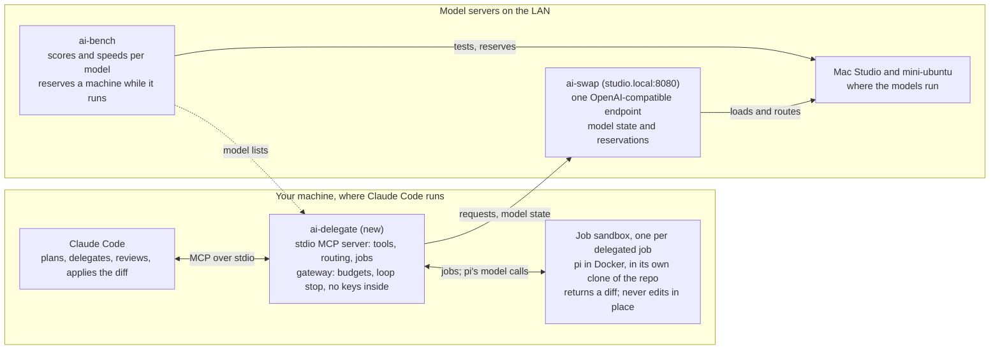

# ai-delegate: design

Status: M1, M2 and M3 built 2026-11-13 (the Houtini trial was skipped). Written 2026-11-10;
where the build departed from this design, the section says so.

## Purpose and scope

ai-delegate is a planned fifth tool in the suite: an MCP server that lets Claude Code hand bounded work to the local models behind ai-swap, while Claude keeps the planning and the final say. M1 is built; the Houtini trial was skipped in favour of trialling M1 itself (see Evaluation plan).

- In scope: short questions and reviews answered by a local model, and delegated coding jobs that run in a throwaway copy of the repo and come back as a diff.
- Out of scope: running Claude Code itself on a local model (`claude-swap` already does that), and multi-task orchestration (that is ai-factory).

## Prior art

Two existing servers cover the two halves of the idea; neither knows anything about how our models are hosted.

| Project | Pattern | What it does | Backends |
| --- | --- | --- | --- |
| [Houtini LM](https://houtini.com/tools/houtini-lm/) (`@houtini/lm`, Node) | Ask | `chat` for delegated questions, `code_task` for low-temperature code review; Claude stays the architect and checks the output | Any OpenAI-compatible endpoint (LM Studio, Ollama, vLLM, llama.cpp, hosted APIs) |
| [local-vibes](https://github.com/OpenSourceWTF/local-vibes) | Delegate | The local model runs its own agent loop with file and shell tools in a working directory, then returns a summary and a git change report; installs as a Claude Code plugin with a skill that says when to delegate | OpenAI-compatible (Ollama by default) |

What the suite adds that they lack:

- **Swap awareness.** ai-swap knows which model is loaded on each machine and when ai-bench has a machine reserved. Swapping a model in takes a minute or more, so routing to a loaded model matters.
- **Measured routing.** ai-bench has per-model scores and speeds, so each tool can default to the model that measured best for that kind of work.
- **A proven agent harness.** ai-factory already runs pi in a sandbox behind a gateway with budgets and loop detection, and the future-lab run shook out its failure modes (see Long-running jobs and limits).

## Tools exposed to Claude Code

Six tools in two groups: quick calls that answer within one MCP request, and delegated jobs that run for minutes and are polled.

| Tool | Group | Takes | Returns |
| --- | --- | --- | --- |
| `models` | Quick | nothing | Each model: machine, loaded or not, context window, measured speed, what ai-bench rates it for |
| `ask` | Quick | A prompt, optional files to include, optional model | The model's answer, the model used, tokens and seconds |
| `review` | Quick | A diff or files, and what to look for | Findings as a list, low temperature |
| `delegate` | Job | A task in plain words, the repo path, done-when criteria, optional model and time limit | A job id at once |
| `job_status` | Job | A job id | State, elapsed time, the agent's last few actions |
| `job_result` | Job | A job id | Summary, the diff, test output if it ran tests, and how to apply the diff |

Claude decides what to delegate; a skill shipped with the server says when delegation pays (mechanical edits, boilerplate, first drafts of tests) and when it doesn't (design, anything needing the whole conversation).

- Open question: whether `review` earns its own tool or is `ask` with a preset prompt. M1 makes it a tool: its own system prompt, temperature 0.2, and `git diff` ranges read by the server.

## Architecture

ai-delegate is a local stdio MCP server, a new repo in the suite, that uses ai-swap as its only way to reach models.

Claude Code talks only to ai-delegate; every model call, including the sandboxed agent's, goes through ai-delegate's gateway to ai-swap, which picks the machine.

Why a separate project and not part of ai-swap:

- **Delegation needs the working tree.** A job works on the repo Claude is in, so it must run where Claude Code runs. ai-swap runs on the model servers.
- **ai-swap stays a router.** It loads models and routes requests; an agent loop, worktrees and Docker don't belong in it.
- **What ai-swap may gain:** a small, stable status endpoint for routing, if the current one isn't enough. The quick tools could later also be served from ai-swap over HTTP (open question).

## Model routing

A call names a model, or names a kind of work and lets ai-delegate pick; either way the pick avoids making a machine swap models when it can.

1. **Kind of work → candidates.** Each tool has an ordered list of models, taken from ai-bench results: for example fast drafting on flint or nemotron-lightning, careful review on ThinkingCap. The lists live in config and are regenerated from ai-bench, not hand-maintained.
2. **Prefer what is loaded.** ai-swap reports each model's state. A loaded candidate wins over a better-ranked one that would need a swap, unless the call says otherwise.
3. **Respect reservations.** While ai-bench has a machine reserved, its models are skipped; if no candidate is left, the call says so instead of waiting silently.
4. **Report the choice.** Every result names the model and machine used, so Claude (and the user) can see what answered.

This is the same swap-avoidance idea as ai-factory's residency rules, read from the same ai-swap status endpoint.

## Delegation safety

A delegated job never touches the user's working tree: it works in its own copy of the repo and hands back a diff that Claude decides whether to apply.

- **A clone per job (built; was "worktree per job").** A `git worktree`'s `.git` is a file pointing into the caller's `.git`, a path that doesn't exist inside the container, so git would fail there. Each job instead gets a `git clone --local` (objects hard-linked, so cheap) at HEAD plus the caller's uncommitted changes by default, committed in the clone as the job's base. It adds no branches to the caller's repo, and its `origin` is removed. It is kept until the job is discarded.
- **Diff back, not edits in place.** `job_result` returns the diff and the commands to apply it; Claude reviews it like any other change.
- **Sandbox by default (built).** Two levels. `docker` (the default): pi runs in a container with only the clone mounted, reusing ai-factory's executor image. The container is on an internal Docker network whose only other member is a relay (socat) to this process's gateway, so the agent reaches its model and nothing else. `local`: pi runs as a host process in the clone, with no isolation; results say so. A repo's toolchain comes from `.ai-delegate/Dockerfile` (or ai-factory's `.ai-factory/Dockerfile`), built once and cached by hash, because the base image has no language runtimes.
- **Possible middle level (not built):** `local` under macOS `sandbox-exec` (Seatbelt), limiting writes to the clone and network to the gateway, while keeping the host's toolchains.
- **Budgets.** Per job: wall-clock limit, model calls, new tokens (counted as in ai-factory#18), and changed lines. Hitting one ends the job with what it got so far.
- **No secrets in the sandbox.** Node API keys stay on the host side of the gateway, as in ai-factory.

## Long-running jobs and limits

Local models are slow enough that delegation has to be asynchronous: ThinkingCap on the R9700 writes about 37 tokens a second, and future-lab's tasks took 35 to 100 minutes each.

- **Start, then poll.** `delegate` returns a job id immediately; Claude checks `job_status` and collects `job_result`. Quick tools (`ask`, `review`) keep a short limit and say so when a model is too slow for it.
- **Output budget for thinking models.** Give agents a quarter of the context window per reply, up to 32k tokens; at 8k, ThinkingCap reasoned until it was cut off and wrote nothing (ai-factory#16).
- **Long output lines.** Read agent output in chunks; pi's JSON events can carry a whole file on one line (ai-factory#15).
- **Count new tokens.** Budget the prompt the model hasn't seen plus its output, not every resent prompt (ai-factory#18).
- **Tell the agent its tools.** Give pi its grep, find and ls tools, with rg, fd and jq installed, and say so in the briefing (ai-factory#20).
- **Don't trust a "no problems" note over the tests.** Act on an agent's report only when the tests agree (ai-factory#17).

## Configuration and install

Install is one command per machine that runs Claude Code, and the suite keeps it up to date like the other tools.

- **Register with Claude Code:** `claude mcp add ai-delegate -- ai-delegate serve` (stdio). `ai-swap-clients` could add it alongside the providers it already writes.
- **Config** in `~/.config/ai-delegate/config.yaml`: the ai-swap endpoint (default `http://studio.local:8080`), per-tool model lists (generated from ai-bench), budgets, and sandbox on or off.
- **Suite integration:** a new repo cloned by `./suite clone`, updated by `./suite update`, and listed in the suite README and ARCHITECTURE; `ai-delegate doctor` checks ai-swap is reachable, Docker works, and the image is present.
- **Language:** Python, to share pi and gateway code with ai-factory and results parsing with ai-bench (open question below).

## Evaluation plan

Before building anything, use Houtini LM against ai-swap for a few days of real work, between ai-factory runs, and keep notes on what delegation is worth.

- **Setup:** `claude mcp add houtini-lm -- npx -y @houtini/lm` with `HOUTINI_LM_ENDPOINT_URL=http://studio.local:8080/v1`.
- **Note for each delegation:** what was asked, which model answered, how long it took, whether Claude used the answer as is, fixed it, or redid the work, and whether a model swap happened.
- **Build ai-delegate if** delegated answers are kept more often than redone, and the misses trace to things ai-delegate fixes: swaps, wrong model for the job, or work that needed an agent loop rather than one answer.
- **Don't build it if** Claude ends up redoing most delegated work; then the bottleneck is the models, not the plumbing.
- **Watch during the trial:** that ai-factory runs aren't slowed by swaps the trial causes (the reason to trial between runs).

## Milestones and open questions

Each milestone is usable on its own; the trial decides whether the later ones happen.

1. **Trial:** skipped 2026-11-13; M1 was built directly, and the trial notes are kept on M1 instead. The gate for M2 is unchanged: the build criteria are met.
2. **M1, quick tools (built):** `models`, `ask`, `review` over stdio, with swap-aware routing from ai-swap's status.
3. **M2, delegation (built):** `delegate`, `job_status`, `job_result`, plus `job_cancel` and `job_discard`, with a clone per job and pi in the sandbox; budgets and the diff-back flow. The gateway is a lean copy of ai-factory's (pinning the model, counting calls and new tokens, stopping repeats), not a shared library: ai-factory's is bound to its database.
4. **M3, measured routing and the skill (built):** `ai-delegate routes --write` ranks pinned copies (`model@machine`) per tool from ai-bench's per-machine tables into `routes.yaml`, matching on engine, with a name map for the rest. `skills/ai-delegate/SKILL.md` (installed with `ai-delegate skill`) says when to delegate.

5. **After M3 (built 2026-11-13):** `research` (read-only codebase research with citation checking), `job_revise` (another attempt in the same clone, with feedback), `feedback` (outcomes: kept, fixed, redone, unused), and `capabilities` (a live planning briefing). Tool calls feed a token ledger: what each call cost Claude against an estimate of the native cost, net of results rated redone or unused. The server instructions and the skill make saving Claude's tokens part of its goal. The evaluation plan's notes are now `feedback` plus `ai-delegate stats`.

Open questions:

- [x] Python (shares ai-factory's pi and gateway code) or TypeScript (the MCP ecosystem's default)? Python, with the official `mcp` SDK (2.x).
- [ ] Is the native-cost estimate good enough? It counts what Claude would have read (files, diffs, what a local agent read), not the reasoning it would also have done. Compare it with real sessions' token use once there are some.
- [ ] Web research for local models: port ai-factory's `research.py` (SearXNG search, public-only fetch) once a SearXNG instance runs on the LAN.
- [ ] Should the quick tools also be served by ai-swap itself as an HTTP MCP endpoint, so any machine can use them without installing ai-delegate?
- [x] How much of ai-factory's sandbox and gateway can be shared as a library rather than copied? Little as things stand: its gateway and runtime are bound to its database and settings. M2 copies the patterns (gateway accounting, pi flags and event parsing, network relay) and reuses the executor image as is.
- [x] Does a delegated job need the conversation's context, or only the task text and the repo? Built with only the task, done-when, test command and the repo; the skill tells Claude to make the brief complete. Revisit if jobs fail for lack of context.
- [ ] What MCP tool-call time limit does Claude Code apply, and is it configurable, for `ask` on slow models?
